# 📱 Android 界面组件实验（实验三）

本项目是《Android 移动应用开发》**实验三：Android 界面组件**的完整实现，从零开始搭建，覆盖 ListView、自定义 AlertDialog、XML 菜单、ActionMode 上下文菜单与 RecyclerView 五大经典界面组件，并在模拟器上完成了全流程真机验证。

---

## 🛠️ 开发环境与依赖

- **项目结构**：单模块 Android 应用（Java，Gradle Kotlin DSL）
- **Min SDK**：API 24（Android 7.0）　**Target / Compile SDK**：API 37
- **AGP**：9.4.1　**Gradle**：9.7.1　**Gradle JVM**：JDK 25（Android Studio jbr）
- **核心依赖**：
  - androidx.appcompat:appcompat（AppCompatActivity、AlertDialog、ActionBar 主题）
  - com.google.android.material:material（Material3 主题、MaterialCardView）
  - androidx.recyclerview:recyclerview（RecyclerView + Adapter + ViewHolder）
  - androidx.constraintlayout:constraintlayout、androidx.activity:activity-ktx

---

## 🧪 实验任务详解

### 任务 1：ListView + SimpleAdapter（含通知）
**要求**：利用 SimpleAdapter 实现列表；注意列表项布局；图片使用 QQ 群附件资源；Toast 显示选中列表项信息；单击列表项发送通知（Icon 为应用程序图标、Title 为列表项内容、内容自拟）。

**实现**（[ListViewActivity.java](app/src/main/java/com/example/ui_components/ListViewActivity.java)）：
1. 数据源使用 List&lt;Map&lt;String, Object&gt;&gt;，通过 SimpleAdapter 把 image/name/desc 三个 key 绑定到 [item_simple_list.xml](app/src/main/res/layout/item_simple_list.xml) 的图片与两行文本上；
2. 列表项布局为「左侧 64dp 图片 + 右侧名称/描述」，带水波纹点击反馈；
3. setOnItemClickListener 中 Toast 显示选中项信息，并调用 sendNotification()；
4. 通知部分按现代规范实现：API 26+ 创建 NotificationChannel、Android 13+ 动态申请 POST_NOTIFICATIONS 权限、setSmallIcon(R.mipmap.ic_launcher)（应用图标）+ setContentTitle(列表项内容) + 自拟内容 + PendingIntent 点击回跳。

<div align="center">
  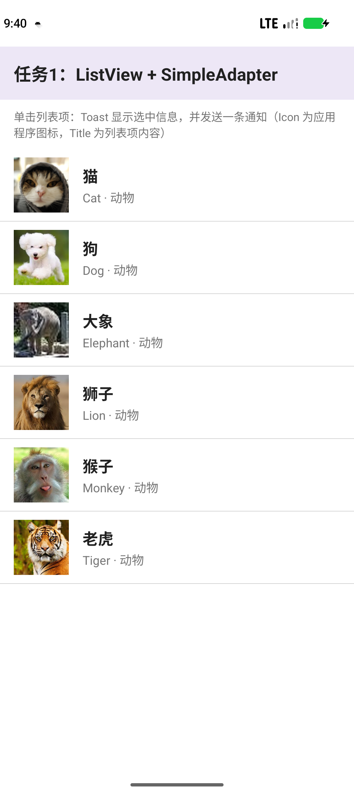
  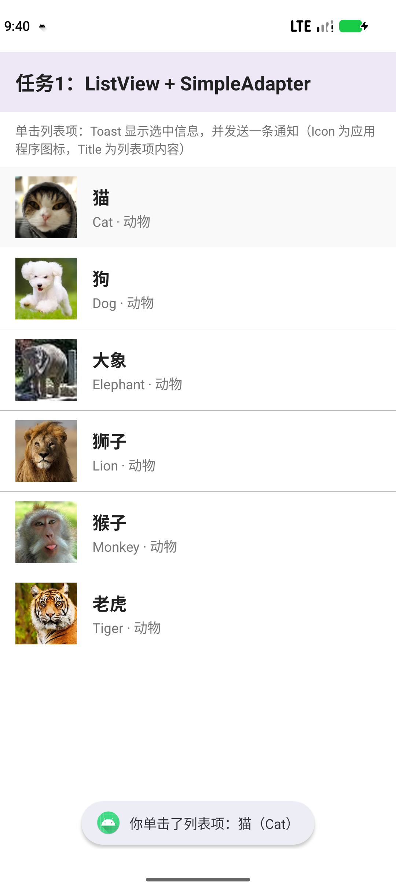
  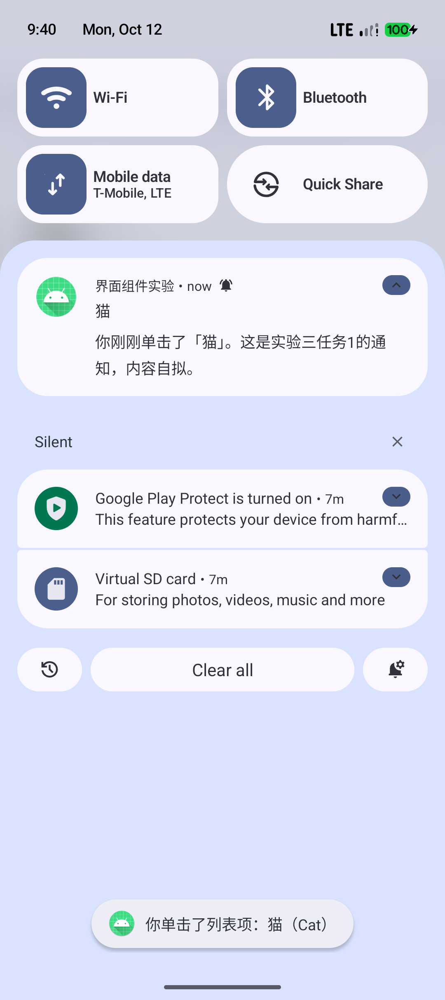
</div>

### 任务 2：创建自定义布局的 AlertDialog
**要求**：创建自定义布局的对话框，调用 AlertDialog.Builder 对象上的 setView() 将布局添加到 AlertDialog。

**实现**（[AlertDialogActivity.java](app/src/main/java/com/example/ui_components/AlertDialogActivity.java)）：
1. 自定义布局 [dialog_custom.xml](app/src/main/res/layout/dialog_custom.xml)（图标 + 标题 + 说明 + EditText）；
2. LayoutInflater.inflate() 加载布局后，通过 new AlertDialog.Builder(this).setView(dialogView) 添加进对话框，setPositiveButton/setNegativeButton 设置「确定 / 取消」；
3. 点击「确定」用 Toast 回显输入内容。

<div align="center">
  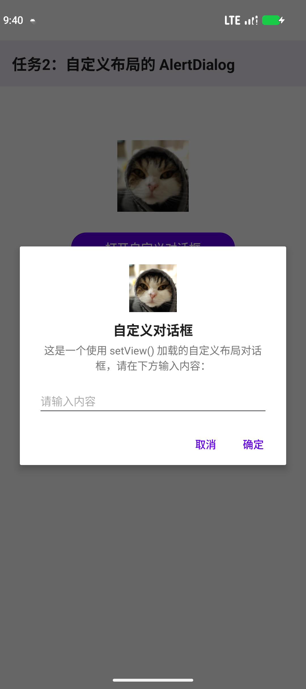
  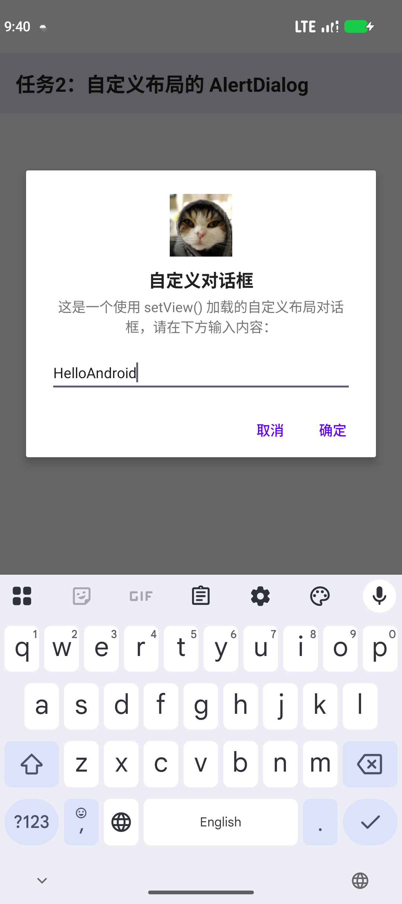
  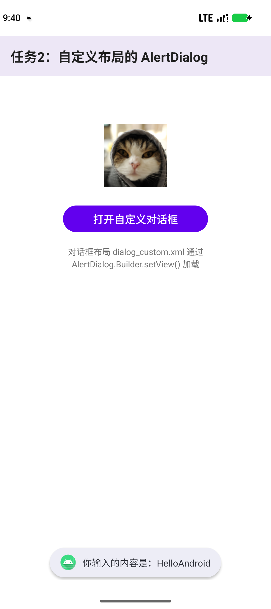
</div>

### 任务 3：使用 XML 定义菜单
**要求**：字体大小（小/中/大 = 10/16/20 号字）点击后设置测试文本字体；普通菜单项点击弹 Toast；字体颜色（红/黑）点击后设置测试文本颜色。

**实现**（[MenuActivity.java](app/src/main/java/com/example/ui_components/MenuActivity.java) + [menu_options.xml](app/src/main/res/menu/menu_options.xml)）：
1. 菜单完全用 XML 定义：两个带子菜单的项（checkableBehavior="single" 单选组）+ 一个普通菜单项；
2. 该 Activity 使用带 ActionBar 的主题（Theme.UI_Components.Menu）显示右上角溢出菜单；
3. onCreateOptionsMenu() 加载菜单，onOptionsItemSelected() 中按 id 处理：setTextSize(COMPLEX_UNIT_SP, 10/16/20)、Toast、setTextColor(Color.RED/BLACK)，并用 setChecked(true) 维护选中态。

<div align="center">
  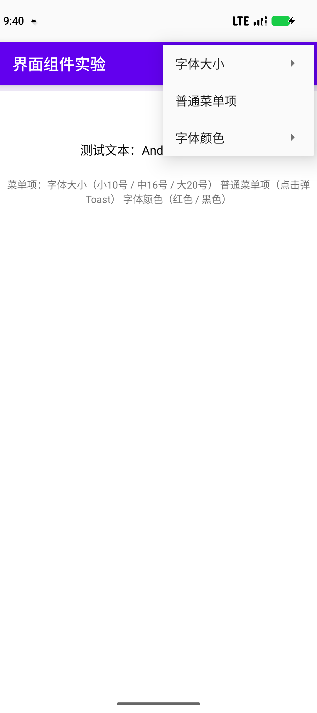
  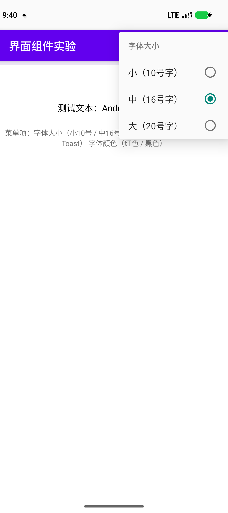
  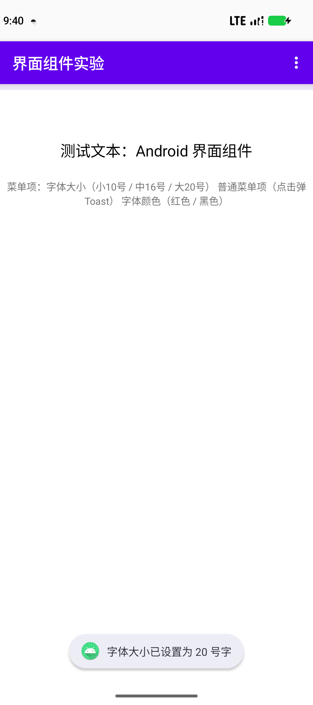
  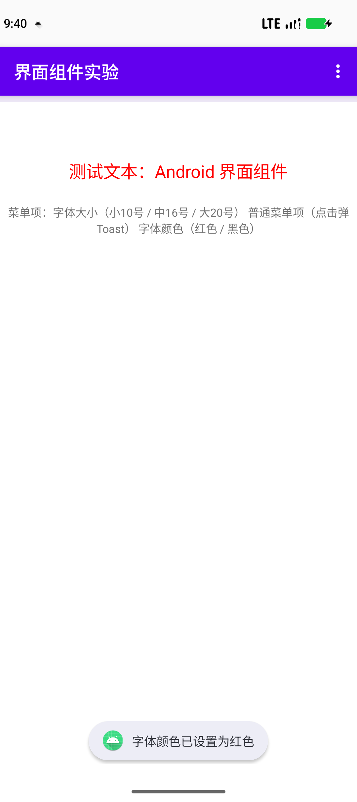
</div>

### 任务 4：创建上下文操作模式（ActionMode）的上下文菜单
**要求**：使用 ListView 创建 List，为 List Item 创建 ActionMode 形式的上下文菜单。

**实现**（[ActionModeActivity.java](app/src/main/java/com/example/ui_components/ActionModeActivity.java) + [menu_context.xml](app/src/main/res/menu/menu_context.xml)）：
1. ListView.CHOICE_MODE_MULTIPLE_MODAL + setMultiChoiceModeListener()，长按列表项即进入 ActionMode；
2. 上下文菜单（复制/分享/删除，带矢量图标，showAsAction="always"）在 XML 中定义，onCreateActionMode() 加载；
3. onItemCheckedStateChanged() 实时更新标题「已选择 N 项」，onActionItemClicked() 弹出对应 Toast 并关闭 ActionMode。

<div align="center">
  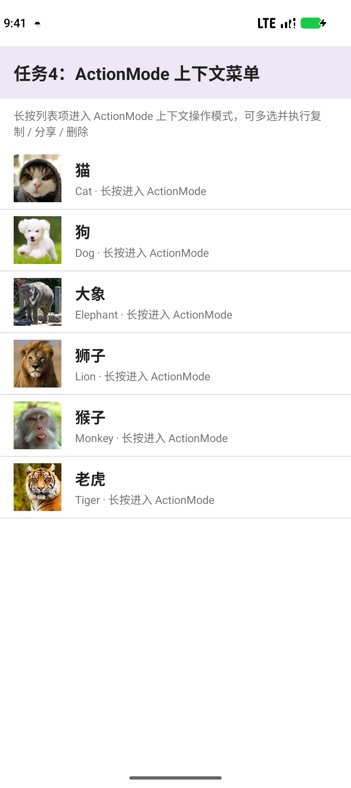
  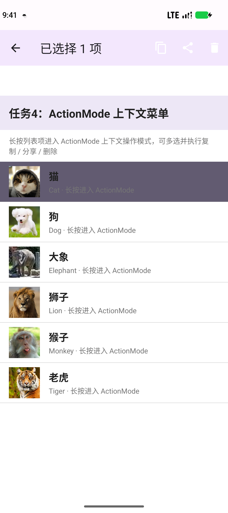
  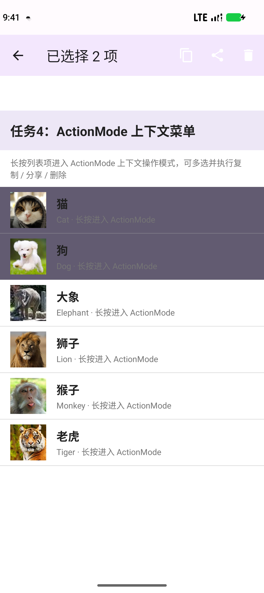
  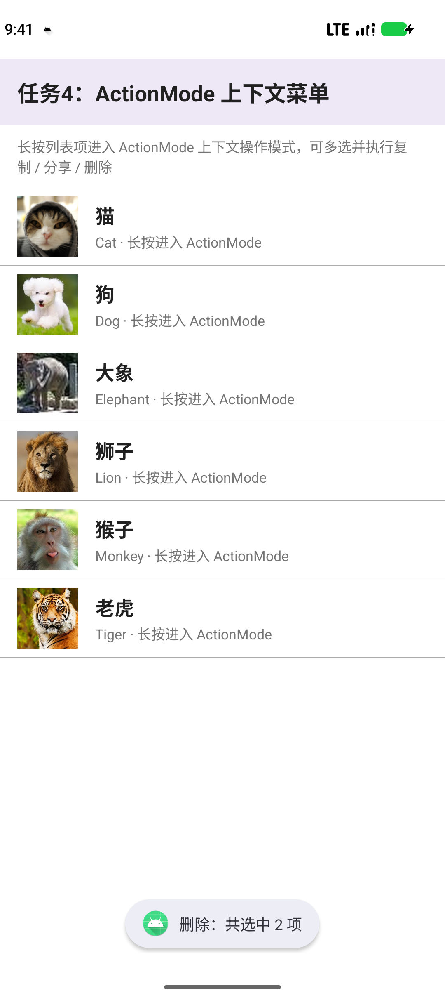
</div>

### 任务 5：使用 RecyclerView 实现列表视图效果
**要求**：使用实验一动物图片资源，列表项包含图片、名称；使用 RecyclerView、Adapter 与 ViewHolder；单击显示名称、增加一条记录后列表立即更新；验证滚动正常、点击对象正确、更新后无错位。

**实现**（[RecyclerViewActivity.java](app/src/main/java/com/example/ui_components/RecyclerViewActivity.java) + [AnimalAdapter.java](app/src/main/java/com/example/ui_components/AnimalAdapter.java) + [item_animal.xml](app/src/main/res/layout/item_animal.xml)）：
1. RecyclerView + LinearLayoutManager，卡片式列表项（MaterialCardView：图片 + 名称 + 英文名）；
2. 自定义 AnimalAdapter extends RecyclerView.Adapter&lt;AnimalViewHolder&gt;：onCreateViewHolder() 解析布局、onBindViewHolder() 绑定数据并注册点击，ViewHolder 缓存控件引用；
3. 单击 → Toast 显示名称 + notifyItemInserted() 局部插入新记录（smoothScrollToPosition() 滚动到新记录），顶部计数实时更新。

**真机验证结果**：滚动流畅；单击「猫」→ Toast「你单击了：猫（Cat）」且记录 6→7；单击「狗」→ 记录 7→8；滚动后 ViewHolder 复用无错位、图片与文字一一对应。

<div align="center">
  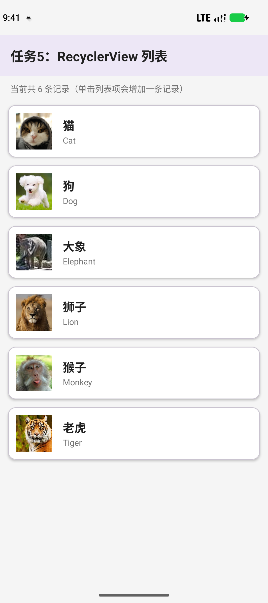
  
  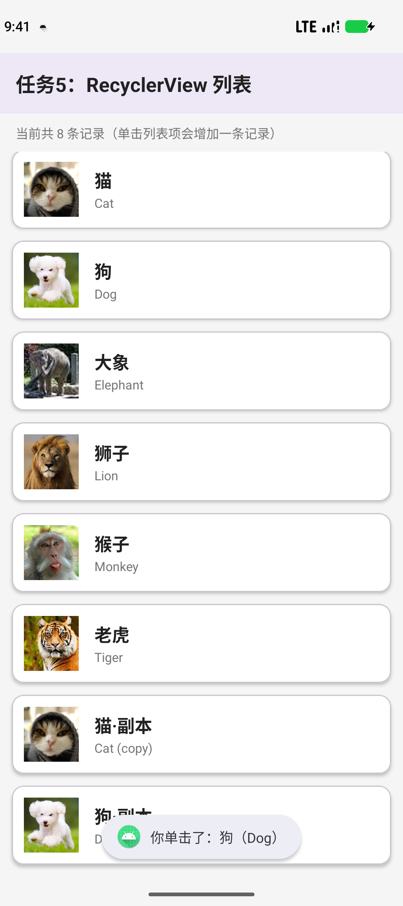
  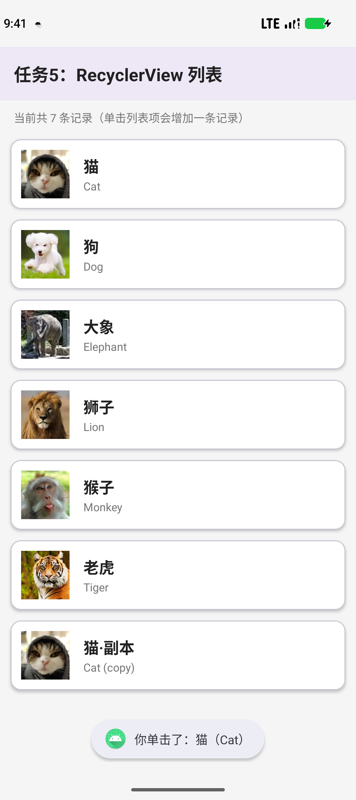
</div>

---

## 📂 项目结构

```
UI_Components/
├── app/src/main/
│   ├── java/com/example/ui_components/
│   │   ├── MainActivity.java          # 主导航：5 个任务入口
│   │   ├── ListViewActivity.java      # 任务1 ListView + SimpleAdapter + 通知
│   │   ├── AlertDialogActivity.java   # 任务2 自定义 AlertDialog
│   │   ├── MenuActivity.java          # 任务3 XML 菜单
│   │   ├── ActionModeActivity.java    # 任务4 ActionMode 上下文菜单
│   │   ├── RecyclerViewActivity.java  # 任务5 RecyclerView
│   │   ├── AnimalAdapter.java         # RecyclerView 适配器 + ViewHolder
│   │   ├── Animal.java                # 动物数据模型
│   │   └── EdgeInsetHelper.java       # Edge-to-Edge 边距工具
│   └── res/
│       ├── layout/                    # 各界面布局 + 列表项布局 + 对话框布局
│       ├── menu/                      # menu_options.xml / menu_context.xml
│       └── drawable/                  # 动物图片（QQ 群附件资源）+ 矢量图标
├── screenshots/                       # 模拟器真机验证截图
└── README.md
```

## ▶️ 运行方式

1. 用 Android Studio 打开本工程（Gradle 会自动同步）；
2. 点击 Run ▶ 选择 Pixel 9 模拟器（API 37）或真机；
3. 主界面选择任务 1~5 进入对应实验界面。

## ✅ 验证记录（Pixel 9 / API 37 模拟器实测）

| 任务 | 验证项 | 结果 |
| --- | --- | --- |
| 1 | 列表渲染 / Toast 内容 / 通知（channel=list_click_channel，icon=应用图标，title=列表项） | ✅ |
| 2 | setView() 对话框显示 / 输入 / 确定回显 Toast | ✅ |
| 3 | 溢出菜单 / 子菜单 / 字号 10-16-20 / 颜色红黑切换 / 普通项 Toast | ✅ |
| 4 | 长按进入 ActionMode / 多选计数 / 复制·分享·删除 Toast | ✅ |
| 5 | 滚动 / 点击对象正确 / 点击加记录 6→7→8 立即更新 / 复用无错位 | ✅ |
